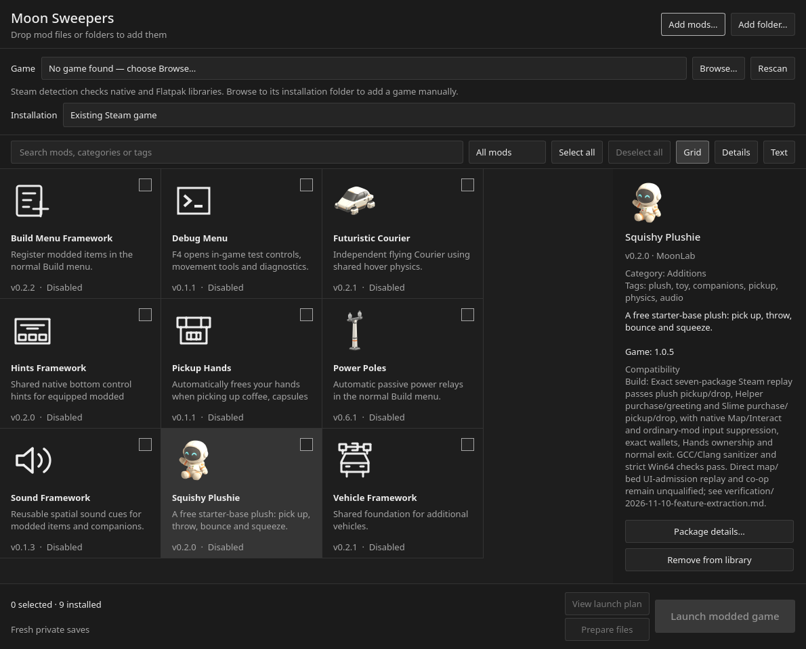

# Moon Sweepers Mod Loader

A desktop mod loader for Moon Sweepers. Install `.msmod` packages, choose your
mods, check dependencies and game compatibility, then launch through Steam.
Available for Windows x64 and Linux x64 with Steam Proton.

[Downloads](#installation) · [Quick start](#quick-start) ·
[Find mods](https://github.com/swooping-mods/mod-index) ·
[Report an issue](https://github.com/swooping-mods/moon-sweepers-mod-loader/issues)



*The bundled library, mod details and file/folder import controls.*

## Contents

- [Installation](#installation)
- [Quick start](#quick-start)
- [Bundled mods](#bundled-mods)
- [Adding mods](#adding-mods)
- [Compatibility and saves](#compatibility-and-saves)
- [Troubleshooting](#troubleshooting)
- [Development](#development)
- [Credits and licensing](#credits-and-licensing)

## Installation

### Choose a build

| Channel | Download | What it includes |
| --- | --- | --- |
| Recommended download | [v0.2.1 release](https://github.com/swooping-mods/moon-sweepers-mod-loader/releases/tag/v0.2.1) | Windows ZIP, portable Linux `.run`, AppImage and tar.gz, source ZIP and `SHA256SUMS`. Desktop downloads include Python/Qt and all nine starter packages. |
| Development builds | [Successful Checks runs on main](https://github.com/swooping-mods/moon-sweepers-mod-loader/actions/workflows/check.yml?query=branch%3Amain) | The same formats and checked bundle from current development. Download `moon-sweepers-mod-loader-builds` under **Artifacts**; GitHub sign-in is required and artifacts expire after 14 days. |

Version 0.2.1 is a full release. See the [changelog](CHANGELOG.md)
and [Releases](https://github.com/swooping-mods/moon-sweepers-mod-loader/releases)
for versioned downloads. The game itself is not included.

### Platform requirements

| Platform | Archive | Start the loader | Requirements |
| --- | --- | --- | --- |
| Windows x64 | `moon-sweepers-mod-loader-VERSION-windows-x64.zip` | Extract the entire ZIP, then open **Mod Loader.exe**. Keep its adjacent folders. | Windows 10/11 x64 and Steam. Python and Qt are included; no administrator access is needed. The launcher is unsigned. |
| Linux x64 — easiest | `moon-sweepers-mod-loader-VERSION-linux-x64.run` | Mark executable, then open the file. It extracts to your user cache and opens the loader. | Modern Linux desktop and Steam Proton. Python and Qt are included; no administrator access or package installation is needed. |
| Linux x64 — AppImage | `moon-sweepers-mod-loader-VERSION-linux-x64.AppImage` | Mark executable, then open. If FUSE is unavailable, run it with `--appimage-extract-and-run`. | The same portable application and bundled mods. |
| Linux x64 — archive | `moon-sweepers-mod-loader-VERSION-linux-x64.tar.gz` | Extract, then open **Moon Sweepers Mod Loader**. This is the single application entry point in the folder. | Python and Qt are included. Keep the adjacent folders. |

On Linux, **Properties → Permissions → Is executable** in Dolphin enables a
single-file download. From a terminal, use `chmod +x FILE`, then `./FILE`.
Portable Linux builds require glibc 2.38+ (for example Ubuntu 24.04 or newer) on an
x64 desktop; Steam/Proton and system
graphics drivers remain external. `MOON_LOADER_PYTHON` can deliberately replace
the included interpreter with your own environment.

The source ZIP includes the native bootstrap but requires your own Python and
PySide6. GitHub's automatic source-code archives require a [native build](#development).

## Quick start

1. Start the loader and select a supported game installation. Use **Browse…** if
   it was not detected.
2. Choose **Existing Steam game** to use your installed game and normal Steam
   saves. Confirm that your saves are backed up, or use a fresh Steam profile.
3. On Linux, open **Steam setup…** to check the required launch options. If a
   change is needed, quit Steam completely, review and apply the proposed change,
   then reopen Steam. See [Proton setup](#proton-setup) for manual setup.
4. Check the mods you want and their required frameworks. **Select all** selects
   the whole library, including mods hidden by search or filters.
5. Click **Launch via Steam**. It applies the selected mods before requesting
   launch; resolve any reported dependency or compatibility problems first.
   **Prepare files** can apply them separately without starting the game.
   Launch progress explains automatic preparation and Steam handoff. A short
   Steam request finishing does not confirm game startup. The loader keeps launch
   blocked while starting, running or unconfirmed; if no game starts or it closes
   before detection, check Steam and use **Game closed / did not start…**.
   Expand **Launch diagnostics** for technical exit codes and log paths.

Search covers names, descriptions, categories and tags. Grid, Details and Text
views share the same filters and selections. Importing packages and preparing
files do not start the game.

## Bundled mods

Desktop releases include these handpicked mods and all five required
dependencies:

| Mod | Repository |
| --- | --- |
| Squishy Plushie | [squishy-plushie](https://github.com/swooping-mods/squishy-plushie) |
| Futuristic Courier | [futuristic-car](https://github.com/swooping-mods/futuristic-car) |
| Power Poles | [manual-power-poles](https://github.com/swooping-mods/manual-power-poles) |
| Debug Menu (F4), for testing | [debug-menu](https://github.com/swooping-mods/debug-menu) |

The included dependencies are **Sound Framework**, **Pickup Hands**, **Hints
Framework**, **Vehicle Framework** and **Build Menu Framework**. All nine packages
appear in the library on first start, initially unchecked. Existing versions and
checkmarks are preserved. The [bundle specification](specs/bundled-mods.md) and
[package lock](vendored/mod-bundle.json) record the exact contents and versions.

## Adding mods

Browse the [Moon Sweepers Mod Index](https://github.com/swooping-mods/mod-index),
then download the mod's `.msmod` file and any required framework packages from
their repositories. The index is a separate website; the loader imports local
packages.

Version 0.2.0 supports these local import methods. Imported mods stay unchecked;
existing versions and selections are preserved:

| Method | Accepted input |
| --- | --- |
| Drag and drop onto the loader | One or more `.msmod` files, supported ZIP downloads or extracted mod folders. |
| **Add mods…** | Select one or several `.msmod` or supported `.zip` files with the file picker. |
| **Add folder…** | Choose an extracted folder containing `.msmod` files or unpacked packages with manifests. |

The importer also recognizes the complete **MarsSweepers 0.6.1** download.
The supported BepInEx adapter/runtime is included in release and prerelease
downloads. Use **Existing Steam game** to run native and BepInEx mods through
your normal Steam installation, without copying the game. The first managed
launch generates game bindings locally and can take longer. Mars itself is
supplied separately and starts unchecked after
import. Its compatibility companion adds bounded multiplayer messages, initial
state retries and host setting checks; real co-op remains unqualified. Other raw
third-party DLLs require a compatible mod package. See the
[managed runtime contract](specs/managed-runtime.md).

If Mars was imported with an older loader, import the complete download again
to pick up the updated compatibility companion. Existing library packages are
kept immutable.

**Private game copy** remains optional and needs a clean source game folder to
create its first copy. Uninstall preserves settings and logs, so it does not
automatically produce a clean source for this option. Existing private copies
remain available.

## Compatibility and saves

**Compatibility…** checks your installed game against reviewed executable
hashes and explains which game APIs and framework providers each selected mod
needs. You can inspect an unknown game build even when launching is blocked.
Per-mod details can check a mod and its required frameworks without selecting
them. “Requirements matched” means its declared contracts are available;
gameplay, saves and co-op need separate verification. Package author notes are
shown separately from the loader's assessment.

New native v8 mods can use the shared game adapter so the same mod binary can
work on another reviewed game profile with matching APIs. An adapter update is
still needed for a changed game build. Existing mods containing game-specific
addresses and the current BepInEx host retain their exact supported build;
matching a version label does not bypass those checks.

For a report without importing/preparing/starting mods, use
`--compatibility --game PATH` (with your usual `--data`/`--bundle` if needed).

The adapter targets the pinned Steam Windows x64 IL2CPP **1.0.5** build
(app **5335510**). Exact executable hashes determine compatibility; the version
label alone is insufficient. Other builds require a matching adapter.

**Existing Steam game** adds owned loader files and selected mods without copying
the game or replacing original game DLLs. It uses normal Steam saves. Back up the
save folder and its sidecars before enabling mods that affect saves, or choose a
fresh Steam profile. The loader can back up an explicitly selected save folder.

**Private game copy** keeps a separate copy and modded profile. Existing private
profiles remain available. See [deployment details](specs/public-deployment.md)
for path requirements, conflicts and recovery.

### Proton setup

For **Existing Steam game** on Linux, **Steam setup…** shows the current and
proposed launch options for your most recent Steam account. To apply a repair,
quit Steam completely, click **Apply required launch options**, then reopen Steam.
The loader preserves other options and keeps a backup in its data folder. It
checks setup before launching selected mods. Windows needs no Proton option.

For manual setup, open the game's **Properties → General → Launch Options** in
Steam. With no existing options, use:

```sh
WINEDLLOVERRIDES="version=n,b;winhttp=n,b" %command%
```

Native mods require `version=n,b`; BepInEx also requires `winhttp=n,b`. If you
already use launch options, merge the required overrides while keeping your
other overrides, wrappers and arguments. **View launch plan** shows the
selected deployment mode and launch settings. A successful Steam launch request
does not confirm that the game started or loaded mods.

### Disable or remove mods

**Disable mods** takes effect on the next game start. **Uninstall loader** removes
unchanged files owned by the loader and retains settings and saves. Files changed
externally are preserved and reported. Removing mods cannot make every modded
save compatible with vanilla.

Launcher and package checks cover installation behavior. Native Windows gameplay,
the full nine-mod combination in a loaded world, save/reload, real co-op and
physical controllers require separate qualification.

## Troubleshooting

| Problem | What to check |
| --- | --- |
| Missing dependency | Import and select the frameworks declared by the mod. **Select all** is convenient for the starter bundle. |
| Unsupported game build | Check the installation selected in the loader. Compatibility uses executable hashes; renaming files does not make another build supported. |
| Different buttons or an empty library | Check the version. v0.1.0 predates the starter bundle and new import controls; use v0.2.0 or a newer checked build. |
| Linux loader does not open | Confirm executable permission and keep the complete extracted folder. Try the `.run` download or AppImage's `--appimage-extract-and-run` fallback. Remove an unintended `MOON_LOADER_PYTHON` override. |
| Steam opens but mods do not load on Proton | Check the [Steam launch options](#proton-setup) and **View launch plan**. |
| A launch or the loader fails | Click **Open logs** for saved informational messages, errors, tracebacks and available crash diagnostics. |

Application data is stored in `%LOCALAPPDATA%/MoonLab/Loader` on Windows and
`$XDG_DATA_HOME/moonlab-loader` (normally `~/.local/share/moonlab-loader`) on Linux.
Use `--data PATH` to choose another location, or `--no-launch` to inspect the UI
with launching disabled.

Diagnostics are saved under the data folder's `logs/`, including rotating
`loader.jsonl` files and Python fatal-crash logs. Individual launches retain
their process output and available private game/BepInEx log tails. **Open logs**
also refreshes fresh installed-bootstrap logs belonging to the prepared mod
generation. A completed Steam request does not establish game startup, lifetime
or a crash; unavailable evidence is reported as unconfirmed. Logs stay local.

Report loader, installation and launch issues in
[this repository's issue tracker](https://github.com/swooping-mods/moon-sweepers-mod-loader/issues).
Include the loader build, operating system, game build and the error shown.
Report gameplay issues in the mod's repository.

## Development

Use installed **Python 3.11+**, **PySide6 6.8–6.x** and the LLVM cross tools
`clang`, `lld-link` and `llvm-dlltool`. Commands run from the repository root:

```sh
./run.sh --no-launch --data local/review
python3 tools/check.py
python3 tools/build.py
python3 tools/build_linux.py --inputs /path/to/reviewed-linux-inputs
python3 tools/check_linux_bundle.py --gui
```

On Windows, use `Start-Mod-Loader.cmd` or
`py -3 loader/main.py --no-launch --data local/review` to run the desktop source.
To package Windows offline, supply the reviewed inputs pinned in
`vendored/windows-runtime.lock.json`:

```sh
python3 tools/build_windows.py --inputs /path/to/reviewed-inputs
python3 tools/check_windows_bundle.py
```

Builders download nothing. Build outputs and verification receipts go under
ignored `artifacts/`. The full host check includes Qt interactions;
`python3 tools/check.py --host-only` explicitly excludes three Qt tests on runners
without PySide6. CI builds Windows and all three Linux formats, checks their real
entry points and bundled Qt, and runs the actual EXE on Windows. Version tags run the
same gates before publishing prerelease assets. Full releases promote those
checked files without rebuilding them.

### Mod authoring and project documentation

The loader pins [Moon Sweepers API](https://github.com/swooping-mods/moon-sweepers-api)
**0.7.0**. Native v6/v7 mods use its runtime registry; v7 declares exact adapter
ABIs in `requires_host`. Unsupported hosts or missing capabilities reject before
game preparation. Native v8 adds declared game capabilities and a scoped broker;
see [the game adapter contract](specs/game-adapter.md). Gameplay frameworks remain separate mods.

- [Contributing](CONTRIBUTING.md): development and release workflow.
- [Native mod authoring](specs/native-adapter.md): checked bindings in `sdk/native/`.
- [Managed runtime](specs/managed-runtime.md): optional BepInEx attachment and private mode.
- [Windows packaging](specs/windows-packaging.md) and [Linux packaging](specs/linux-packaging.md).
- [CI](specs/ci.md): required checks and distribution artifacts.
- [Specifications index](specs/_readme.md): current implementation contracts.

## Credits and licensing

Bundled mods retain their authorship and provenance in the
[package lock](vendored/mod-bundle.json) and
[third-party notices](vendored/THIRD_PARTY_NOTICES.md).

Both desktop bundles include Python, Qt/PySide notices, licenses and matching
Qt/PySide sources in `LICENSES/`. Windows also retains Microsoft runtime notices;
Linux includes portable Python, ICU and AppImage component notices/source.
Shared libraries remain replaceable.
No project-wide license has been assigned.
