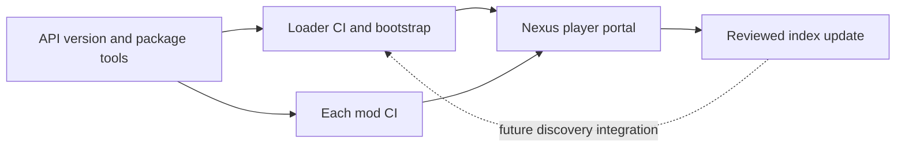

# Swooping Mods repository split

## Proposed organization

Use [swooping-mods](https://github.com/swooping-mods), with these explicit game-prefixed repository names. They remain understandable in search results and leave the organization free to host other games.

| Repository | Owns | Main consumers |
|---|---|---|
| `moon-sweepers-api` | Versioned hook headers, package format and offline package tools | Loader and mod authors |
| `moon-sweepers-mod-loader` | Desktop app, native bootstrap, game compatibility pins, deployment and launch | Players |
| `moon-sweepers-mod-index` | Catalog metadata, release checksums, dependency links and Nexus file IDs | Discovery tooling and contributors |

The API is an SDK, not a hosted service. It defines the contract; the loader implements it. The index is static data, not another runtime. The index never owns mod build pipelines or redistributes mod payloads. No separate CI repository or portal website is needed for this initial split.

Give independently maintained gameplay mods their own repository as they are released, for example `moon-sweepers-electricity-lines`. Domain frameworks such as Shop, Equipment, Sound, Vehicle and Build Menu remain versioned mod dependencies; moving all framework implementations into the SDK would couple their game-specific releases. Their public contracts can be promoted to the API once deliberately stabilized. The existing private development checkout retains all mod implementations and assets for now.

## Dependencies and release ownership

The loader commits a content-pinned API snapshot and tests against it. Mods use a pinned SDK release/snapshot. A changed API does not automatically publish downstream mods. Each consumer updates the pin, runs its checks and independently creates its own release artifact.

For each release: build and verify an immutable candidate, record its SHA-256, publish that same candidate to the existing Nexus file, and submit the resulting version/file ID/checksum to the index. The index PR validates the dependency graph and release identity. Player downloads stay on Nexus; GitHub retains source, Issues, PRs and CI artifacts. SDK releases are a developer channel and need not be a player-facing Nexus dependency.

## Issues and PRs

| Problem | Owning tracker |
|---|---|
| Public C ABI, manifest contract, author packager | API repository |
| Desktop UI, discovery, prepare/rollback, launch/bootstrap | Loader repository |
| Catalog inclusion, stale Nexus link, wrong release hash | Index repository |
| Gameplay feature, assets or mod-specific compatibility | That mod's repository |

Nexus descriptions should link to the corresponding GitHub source and issue tracker once those repositories exist. Keep one canonical technical issue rather than duplicating it across repositories; Nexus comments can link to it.

## Local preparation versus future rollout

Prepared: three independent local repositories, focused docs/specs, first-party API extraction, a pinned loader snapshot, native build, existing loader tests, catalog metadata migration and CI candidate definitions. The API and loader source repositories are now hosted privately under `swooping-mods`, with `main` tracking their respective `origin/main`. The index remains local. All migrated catalog entries are explicitly development entries, with no invented mod source/Nexus release links. The generated public index is therefore initially empty.

Deferred: creating/pushing the index repository, branch protections, choosing Nexus pages/file IDs, initial Nexus uploads, uploader intake/credentials and loader integration with a hosted index. The source push does not publish a Nexus release, website or network updater.
